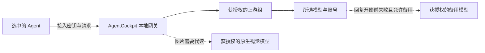

# 本地网关：接入、模型能力与路由

更新于 2026-11-04。

AgentCockpit 的本地网关默认位于 `http://127.0.0.1:8788`。上游是提供模型的账号或 API 服务，下游是使用模型的 Agent；两者可以是不同产品。客户端使用接入密钥，网关再以相应上游的凭据转发请求。

## 从模型来源到 Agent 接入

1. 在 **模型反代** 总页选择上游来源，配置上游组并读取模型目录。账号必须已有效登录，或已登记可用的 API Key。
2. 选择要使用的模型，启动网关并生成或选择接入密钥。密钥限定可使用的上游组；当前界面未勾选任何组表示所有启用的组，需限制范围时应明确勾选。
3. 最后一步 **接入本地网关** 中选择目标 Agent，再选该 Agent 的档案、接入密钥和模型。支持自动配置的普通客户端可点「一键接入」；已有受管配置可点「更新接入配置」。Claude 桌面版已接入后，换模型需先断开并恢复，再选择模型重新接入。
4. 按提示关闭目标客户端后写入配置，再重新启动客户端或新建会话。回到总页查看实时路由和请求结果。

每个 Agent 详情页也提供同一套「接入本地网关」设置。模型来源、模型测试、上游组和密钥统一在模型反代总页维护；无需把来源产品选作下游客户端。

目前自动写入覆盖 Codex CLI/桌面版、Claude Code、Claude 桌面版、Qoder 国内/国际版、WorkBuddy 国内/国际版、OpenCode 和 ZCode 的已适配配置格式。客户端版本、自定义路径或 JSONC 等格式可能需要手工设置；界面会说明，不应把“已选择 Agent”理解为“已经写入成功”。

网关保存接入前的配置，提供「断开并恢复」。如果客户端期间改写了同一配置且无法安全合并，恢复会提示冲突；先核对配置，不要直接覆盖。

### 手工接入

| 配置项 | 常用值 |
|---|---|
| OpenAI 兼容 Base URL | `http://127.0.0.1:8788/v1`，自定义端口时相应替换 |
| API Key | 所选接入密钥，形如 `ac-…` |
| Model | 从这把密钥的模型目录复制完整 ID |

不同客户端会自行拼接路径，因此 Claude/Gemini 等原生协议入口应采用客户端要求的基地址。已适配客户端的一键接入会处理这项差异。

停用或删除接入密钥可收回后续请求的权限。密钥不要进入公开仓库、共享截图或未受保护的同步配置。

## 图片与长上下文

选择密钥后展开 **高级模型设置**。先选模型，再选「仅此模型」或供应商范围；供应商范围用于给该来源的所有模型设置默认 token 限制。模型单独设置优先于供应商默认，留空沿用上游目录或本地公共目录缓存。

这些模型与供应商设置在驾驶舱中共享；每个 Agent 的接入档案独立。修改同一模型的能力会影响使用它的其他客户端。网关目录会动态更新，使用动态目录的客户端可在重新读取后获得新值；把模型能力保存在本地配置的客户端需更新接入配置并新开会话。Claude 桌面版改接入模型需按前述步骤断开重接。

| 设置 | 含义 |
|---|---|
| 图片输入：自动 | 使用目录声明的原生图片能力；纯文本模型可由同一把密钥下可用的原生视觉模型代读 |
| 原生读图 | 在上游确实支持图片、且适配器能传图片时使用；修改声明不能使文本模型凭空获得视觉能力 |
| 指定视觉模型代读 | 图片先交给指定视觉模型，目标模型收到图片描述；可用于目标模型或桥接协议只支持文本的情况 |
| 仅文本 | 不启用代读；遇到图片请求返回明确错误 |
| 上下文窗口 | 告知已适配客户端模型可接受的上下文长度 |
| 最大输出 | 告知客户端输出 token 上限；Anthropic 请求未提供 `max_tokens` 时可使用此值 |
| 压缩阈值 | 供已适配的 Codex、Claude Code 长对话压缩配置使用，其他客户端不保证支持 |
| 推理思考 | 低 / 中 / 高会作为 `reasoning_effort` 注入请求；关闭会剥掉客户端自带的推理参数，上游是否支持以各厂商为准 |

数值可填 `128K`、`1M` 等，K/M 分别按 1,000/1,000,000 换算。输出和压缩阈值不会被声明为超过有效上下文窗口。客户端最终是否接受某字段仍取决于其版本和协议。

上游组弹窗里的每个来源行都有「停用」开关。停用的来源会收进弹窗底部的「已停用的来源」折叠区，网关立即不再把它纳入模型目录和任何上游组；需要时在折叠区里点「启用」恢复。这是来源级的总闸，与来源在不在某个上游组里无关。

**图片代读会增加一次或多次模型调用**，并把图片发送给所选视觉模型；描述可能遗漏细节。只会选择该接入密钥有权使用的模型，不能借此访问另一把密钥的上游。无法原生传图且没有可用代读模型时，网关会报错，不会把图片静默丢成空文本。

## 供应商调度

在高级设置中切换到供应商范围，可配置：

| 设置 | 行为 |
|---|---|
| 每个账号的并发上限 | 达到上限后进入该账号的等待队列 |
| 同时使用的账号数 | 从上游列表的前几个可用账号中选择；不可用账号可由后续账号接替 |
| 每个账号每分钟请求数 | 达到 RPM 后等待新空位；RPM 等待最长两分钟，并受更短的排队等待限制 |
| 每个账号的排队上限 | 达到等待队列上限后拒绝新请求 |
| 排队等待 | 等待的最长秒数 |
| 备用模型/路由组 | 首选模型无法开始回复时，尝试有权使用的备用项 |
| 顺序 / 免费优先 / 价格优先 | 决定备用项的尝试顺序；无法取得价格时不假设为零 |

数值为 0 或留空表示不设置相应限制；RPM 仍受上述两分钟等待边界约束。账号数、并发与 RPM 是本机网关的调度限制，不能替代上游自己的限流。

备用项仍受**发起请求的接入密钥**授权范围约束。遇到可重试的额度、限流、连接或服务错误时可换账号/模型；请求格式错误等不会无限重试。**一旦已开始向客户端发送回复内容，就不会重新播放该次请求**，避免重复内容或工具调用。需要备用的模型也应具有合适的上下文与工具能力。

## 单价、倍率与用量估算

- 模型范围可填写每百万 token 的美元输入/输出单价，以及缓存读写单价；留空恢复目录价格。
- 供应商范围可设价格倍率；模型已单独设置价格时，不再叠加供应商的普通价格倍率。
- 时段倍率按运行驾驶舱的电脑本地时间计算，按列表采用第一个匹配时段；跨午夜时段按开始日判断星期，未勾星期表示每天。时段倍率也作用于单独设置的模型价格。
- 「对我免费」影响选路排序，保留原有价格和费用估算，不把历史费用改成零。
- 「刷新公开模型价格」向 models.dev 获取公共目录；只有名称精确匹配的厂商模型条目用于补全，不猜测渠道别名的价格。

费用只依据网关实际取得的 token 用量计算，界面分别显示已计价请求、缺用量请求和缺单价请求。改价后历史估算会按新的设置重算。**它是本地估算，不是账单，也不是硬性消费上限**；订阅抵扣、免费额度、积分制、供应商特殊计价和失败请求计费均以官方结果为准。

## 实时路由与实测次数

**实时路由** 展示已发生的请求：Agent → 本地网关 → 上游尝试，并显示排队、尝试、回复、改道与结果。没有请求时显示等待状态，不用演示连线冒充真实流量。账号默认打码；可选一条最近请求查看其尝试过程。路由统计从本次网关进程启动累计，保留最近 64 条请求，重启后重新开始。

模型表中的 **实测次数** 是另一项统计，保存在 `proxymodel.json`：网关记录的模型调用结果和面板手动测试会累计，成功/失败均计入。只是获取模型目录、刷新页面或填写配置，不会增加实测次数。读取列表时带回最新计数；手动测试结束后刷新该模型结果。它不是上游服务的终身调用数，也不等同于 token 用量账本；协议内的重试、代读和逐模型测试可能形成多笔记录。

## 协议与模型 ID

网关提供 OpenAI Chat Completions、Responses、Anthropic Messages 和 Gemini 兼容入口。不同上游通过对应适配器处理，具体能力取决于模型和传输链路，不能因入口兼容就假定所有工具、文件与音视频格式都可用。

内置来源的模型 ID 带来源前缀，例如 `trae/模型名`、`workbuddy/模型名`、`qoder-cn/模型名`。请以接入密钥实际返回的目录为准，避免不同来源的同名模型混淆。选中已授权备用路由后，最终响应可能来自备用模型。

各上游的登录、桥接和令牌约束见 [SUPPORTED_AGENTS.md](SUPPORTED_AGENTS.md)；ZCode 可选桥接的独立许可与安装说明见 [zcode-start-plan.md](zcode-start-plan.md)。

## 常见故障

| 现象 | 排查方向 |
|---|---|
| 无法连接 | 网关是否已启动、端口是否正确，本机代理是否接管了回环地址 |
| 401 / 403 | 接入密钥是否有效、启用，授权上游组是否有可用成员 |
| 模型目录为空 | 所选密钥的上游权限、账号登录态、桥接服务和模型目录刷新结果 |
| Agent 仍提示看不到图片 | 检查模型当前生效的图片能力；更新 Agent 接入配置并新开会话；桥接只支持文本时选择视觉代读 |
| 输出/上下文仍是旧值 | 已写入配置的客户端是否更新配置，客户端是否支持该字段，是否仍在旧会话中 |
| 429 / 等待过久 | 检查并发、RPM、排队上限与等待时间，以及上游自身限流 |
| 502 / 全部备用失败 | 看每次尝试的错误，检查登录态、授权范围和备用模型能力 |
| 实测次数不变 | 确认执行了模型请求或手动测试，而非只拉目录；刷新模型列表并核对完整模型 ID |
| 有请求但没有估算费用 | 上游未返回用量，或该模型缺少可匹配单价；补价不会补出不存在的用量 |

## 日志与使用边界

模型网关默认只监听本机，接入密钥仍应保密。请求与用量记录涉及模型、账号和时间等元数据；失败诊断日志的实际内容见 [隐私说明](PRIVACY.md)，反馈前务必检查。图片代读与备用路由可能让请求到达其他已授权服务，配置前应确认这些服务适合处理请求中的数据。

网关不改变上游服务的授权、服务条款与收费规则。软件许可和责任范围见 [LEGAL.md](LEGAL.md)，设计参考与第三方许可见 [THIRD_PARTY_NOTICES.md](../THIRD_PARTY_NOTICES.md)。
